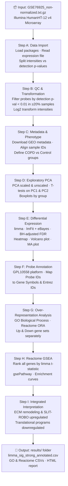

# Transcriptomics Analysis of COPD vs Control Lung Tissue (GSE76925)

Microarray-based transcriptomic analysis of COPD versus control human lung tissue using the GSE76925 dataset, identifying differentially expressed genes and the biological pathways that change with disease.

## Pipeline Overview

## Key Findings

- **PC2** captures a significant disease-associated expression axis in COPD lung tissue
- **Upregulated in COPD:** extracellular matrix remodeling and SLIT-ROBO signaling pathways
- **Downregulated in COPD:** translational machinery and ribosome biogenesis programs
- Findings are consistent across both over-representation analysis (ORA) and rank-based GSEA

## Files

| File | Description |
|------|-------------|
| `Transcriptomics Analysis of COPD vs Control Lung Tissue-GSE76925.Rmd` | Main analysis script |
| `Transcriptomics-Analysis-of-COPD-vs-Control-Lung-Tissue-GSE76925.html` | Rendered HTML report |
| `GSE76925_non-normalized (2).txt.gz` | Raw expression data |
| `results/limma_sig_strong_annotated.csv` | Significant DE genes (FDR < 0.05, \|logFC\| > 0.5) |
| `results/GO_up_COPD.csv` | GO Biological Process enrichment, upregulated genes |
| `results/GO_down_COPD.csv` | GO Biological Process enrichment, downregulated genes |
| `results/Reactome_ORA_up.csv` | Reactome ORA, upregulated genes |
| `results/Reactome_ORA_down.csv` | Reactome ORA, downregulated genes |
| `results/Reactome_GSEA.csv` | Reactome GSEA results |

## Dataset

- **GEO Accession:** [GSE76925](https://www.ncbi.nlm.nih.gov/geo/query/acc.cgi?acc=GSE76925)
- **Platform:** GPL10558, Illumina HumanHT-12 v4.0 Expression BeadChip (microarray)
- **Tissue:** Human lung tissue
- **Comparison:** COPD patients (n = 111) vs controls (n = 40)

## Tools

R, limma, clusterProfiler, ReactomePA, ggplot2

## Author

Mayank Gandhi
